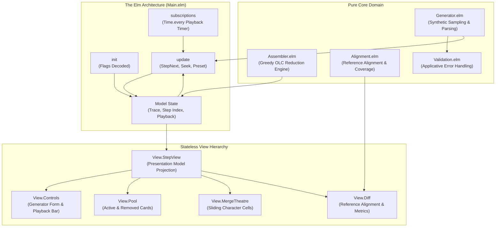
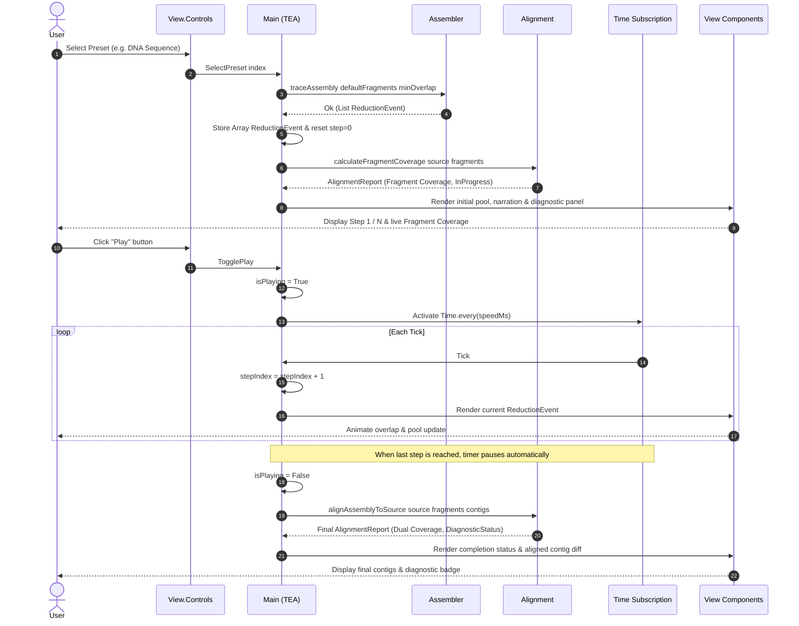

# Interactive OLC Sequence Assembler in Elm

An interactive web-based Overlap-Layout-Consensus (OLC) sequence assembler and
verification workbench implemented in [Elm 0.19.1](https://elm-lang.org/).

The application provides deterministic, client-side assembly of biological and
symbolic sequences from synthetic or user-defined fragment pools. It features
real-time animation, step-by-step playback, sliding-window reference alignment,
dual coverage metrics (fragment and sequence coverage), and differential
parity verification against the Haskell reference implementation.

## 1. Quick Start Guide

### Prerequisites

- **Node.js**: v18.0.0 or later (v24+ recommended)
- **Elm Compiler**: `0.19.1` (installed globally or via npm)
- **GNU Make**: `4.x` or later
- **Python 3**: For serving the local production bundle
- **GHC & Cabal** *(Optional)*: Required only for `make parity` verification
  against `~/dev/haskell/reconstruct-strings`

### Available Make Targets

Project workflows are orchestrated using GNU Make:

| Target      | Description                                                 |
| ----------- | ----------------------------------------------------------- |
| `default`   | Run all verification targets: format, check, lint, test,    |
|             | and build (default goal).                                   |
| `help`      | Show available targets with descriptions.                   |
| `deps`      | Install npm development dependencies via `npm ci`.          |
| `format`    | Automatically format Elm source, test, and review files.    |
| `check`     | Validate Elm code formatting and type-check `src/Main.elm`. |
| `lint`      | Validate formatting and run `elm-review` static analysis.   |
| `test`      | Execute unit and property fuzz tests with `elm-test`.       |
| `build`     | Compile and minify optimised production bundle in `dist/`.  |
| `run`       | Run local HTTP server on port `$(PORT)` (default: 8080).    |
| `parity`    | Run differential parity tests against Haskell binary.       |
| `ci`        | Run full CI pipeline validation (`lint test build parity`). |
| `clean`     | Clean build artefacts and compiler caches.                  |
| `distclean` | Clean all build artefacts, caches, and `node_modules`.      |

### Running the Application

1. **Install dependencies**:

   ```bash
   make deps
   ```

2. **Run verification suite**:

   ```bash
   make ci
   ```

3. **Launch the local web server**:

   ```bash
   make run
   ```

   Open your browser to [http://localhost:8080](http://localhost:8080).

4. **URL Deep Linking**: Initialise specific presets and playback steps via URL
   query parameters:
   - `http://localhost:8080/?preset=0&step=3` (Preset 0 at step 3)
   - `http://localhost:8080/?preset=2&step=0` (English Pangram at step 0)

## 2. Project Structure

```text
reconstruct-strings/
├── .github/
│   └── workflows/
│       └── pages.yml              # GitHub Actions Pages deployment
├── docs/
│   └── REQ-001-interactive-olc-assembler.md # Detailed specification
├── GLOSSARY.md                    # Authoritative domain terminology
├── LICENSE                        # BSD-3-Clause license
├── Makefile                       # Canonical project workflow orchestration
├── elm.json                       # Elm 0.19.1 package configuration
├── package.json                   # Tooling dependencies (elm, terser, review)
├── package-lock.json              # Deterministic npm dependency lockfile
├── review/
│   ├── elm.json                   # Review dependencies
│   └── src/
│       └── ReviewConfig.elm       # elm-review static analysis rules
├── scripts/
│   ├── parity.js                  # Headless Node runner for ParityWorker
│   └── parity.sh                  # Differential parity verification script
├── src/
│   ├── Alignment.elm              # Dual coverage metrics & reference align
│   ├── Assembler.elm              # Pure greedy OLC reduction engine
│   ├── Generator.elm              # Synthetic sampling & input parsing
│   ├── Main.elm                   # Browser.element TEA application wiring
│   ├── Presets.elm                # Four curated sequence presets
│   ├── Validation.elm             # Applicative error accumulation
│   └── View/
│       ├── Controls.elm           # Form inputs & playback control panel
│       ├── Diff.elm               # Reference alignment diff & metrics
│       ├── MergeTheatre.elm       # Sliding-window overlap animation
│       ├── Pool.elm               # Active & removed fragment card grids
│       └── StepView.elm           # Stateless view model projection
├── static/
│   ├── index.html                 # Host HTML page with dark theme shell
│   └── style.css                  # Responsive CSS grid & flex layout
└── tests/
    ├── AlignmentTest.elm          # Unit tests for alignment and coverage
    ├── AssemblerPropertyTest.elm  # Fuzz tests for assembly invariants
    ├── AssemblerTest.elm          # Unit tests for reduction examples
    ├── GeneratorTest.elm          # Bounds validation and parsing tests
    ├── MainTest.elm               # Reducer state-machine transition tests
    ├── ParityWorker.elm           # Headless worker for differential parity
    └── StepViewTest.elm           # View model projection & narration tests
```

## 2.1 Architectural Overview

The application adheres strictly to The Elm Architecture (TEA):

- **Pure Functional Core**: All algorithms in `Assembler`, `Generator`, and
  `Alignment` are total, pure functions that operate independently of UI state
  and DOM representation.
- **Stateless Projection**: Domain events (`ReductionEvent`) are projected into
  transient presentation models (`StepViewModel`) on demand, ensuring zero state
  duplication and preventing state desynchronisation.
- **Single Source of Truth**: The top-level `Model` stores the pre-computed
  reduction trace (`Array ReductionEvent`) and the current playback pointer,
  enabling instantaneous timeline scrubbing and predictable state transitions.
- **Persistent Diagnostics & Dual Coverage**: The Reference Alignment and
  Diagnostics panel is persistently visible from step 0. It tracks both
  **Fragment Coverage** (theoretical coverage of the source spanned by the
  fragment pool) and **Sequence Coverage** (empirical coverage achieved by
  assembled contigs), with real-time semantic status feedback.

## 2.2 Mermaid Component Architecture

The component architecture illustrates the decoupled flow from inputs and
generator engines to The Elm Architecture runtime and stateless view panels:



## 2.3 Mermaid Sequence Diagram

The sequence diagram depicts user interaction during preset selection, reduction
trace calculation, and animated playback:



## 3. Links to Related Projects

This project belongs to a multi-language series exploring functional sequence
reconstruction and greedy Overlap-Layout-Consensus algorithms:

1. **TypeScript Web Implementation**:
   <https://github.com/frankhjung/typescript-reconstruct-strings-web>
   Interactive web application built with TypeScript and HTML5 Canvas.

2. **Haskell Reference Implementation**:
   <https://github.com/frankhjung/haskell-reconstruct-strings> High-performance
   compiled CLI assembler and pure functional reference implementation used for
   differential parity verification.

## License

This project is licensed under the terms of the BSD-3-Clause License. See
[`LICENSE`](LICENSE) for details.
