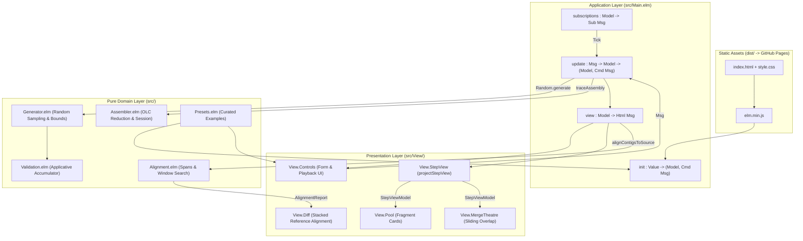
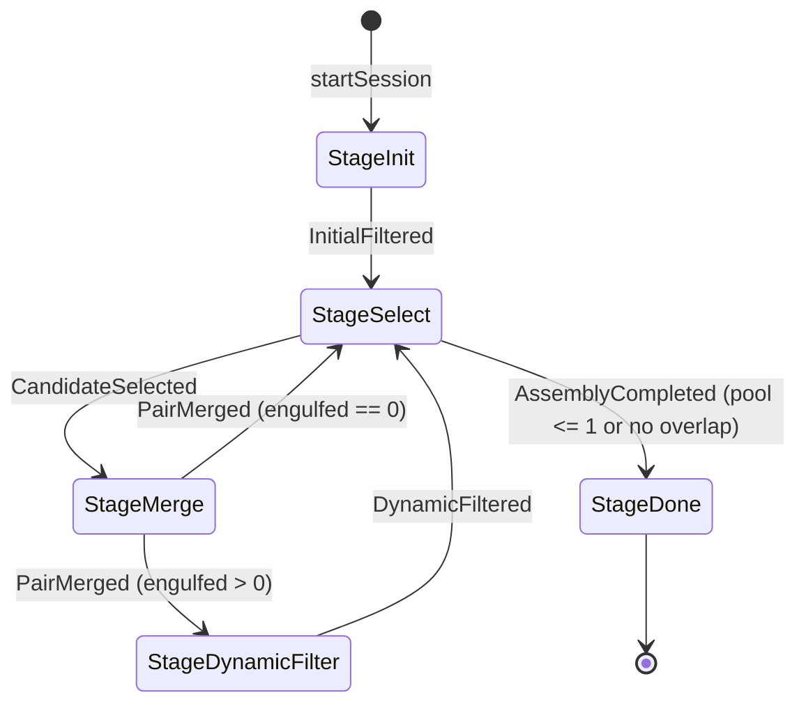
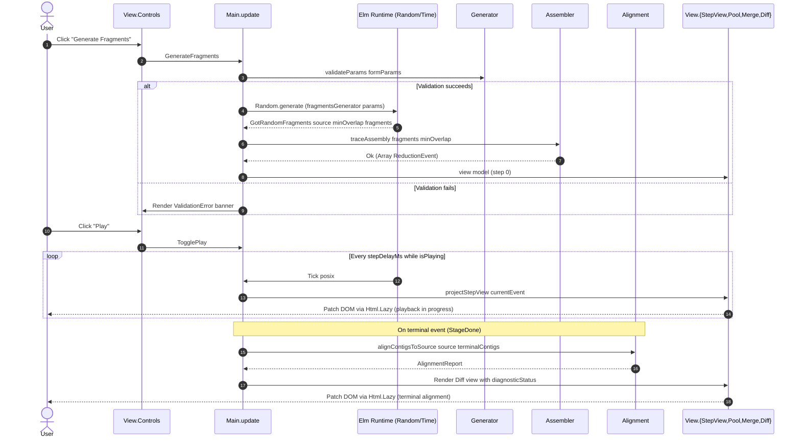

# Interactive OLC Assembler in Elm: Specification and Plan (REQ-001)

> [!NOTE] This document consolidates the domain and architectural requirements
> from the [Haskell reference assembler][hs-repo] (`REQ-001` to `REQ-003`) and
> the [TypeScript web workbench][ts-repo] (`REQ-001` to `REQ-006`) into a
> unified specification and implementation plan for the Elm 0.19.1 application
> in `/home/frank/dev/elm/reconstruct-strings`.

## Goal Description

Build a client-side interactive web application in Elm 0.19.1 at
`~/dev/elm/reconstruct-strings` that animates the reconstruction of random
string fragments using the Overlap-Layout-Consensus (OLC) greedy reduction
protocol and verifies assembled contigs against a ground-truth reference
sequence.

The application serves as both an educational visualisation workbench and an
interactive verification tool. Given a source sequence and generation
parameters, the application:

1. Synthesises random overlapping fragments from the source sequence via Elm's
   pure `Random.Generator` subsystem.
2. Animates the stepwise greedy overlap reduction process in the browser with
   full timeline scrubbing and playback controls.
3. Highlights matching suffix-prefix overlaps with distinct colour coding in an
   overlap and merge theatre.
4. Aligns the resulting contigs against the original source sequence,
   identifying exact matches, uncovered coverage gaps, and chimeric joins.

### Comparison Across Implementations

| Feature | Haskell CLI | TypeScript Web | Elm Web Application |
| :--- | :--- | :--- | :--- |
| Runtime | GHC native CLI | Browser (`esbuild`) | Browser (Elm 0.19.1) |
| Entry | `Main.hs` (`stdin`) | `main.ts` (DOM) | `Main.elm` (`element`) |
| Types | `Fragment`, `Contig` | `string` interfaces | Opaque custom types |
| Validation | `Either Error` | `throw Error` | Applicative `Result` |
| Trace model | Batch reduction | `ReductionEvent` | `ReductionEvent` ADT |
| Session | `reducePool` | `stepSession` | Pure `stepSession` |
| Randomness | `awk` script (`sh`) | `Math.random` | `elm/random` (`Cmd`) |
| Timers | Not applicable | `setInterval` | `Time.every` (`Sub`) |
| View layer | Plain stdout lines | HTML templates | `Html Msg` + `Lazy` |
| Packaging | Cabal executable | Single `index.html` | `dist/` (`elm.min.js`) |

## User Review Required

### Approval before writing to target repository

> [!IMPORTANT] Following `/plan` mode guidelines, the user has requested saving
> the implementation plan directly to
> `docs/REQ-001-interactive-olc-assembler.md` in
> `~/dev/elm/reconstruct-strings`.

### External repository and tool access during implementation

> [!IMPORTANT] When executing the implementation tracks, the build and
> verification workflow will require network access for `npm install` and
> `elm make` package caching, plus read/execute access to
> `~/dev/haskell/reconstruct-strings` for running `make parity`.

## Requirements Review: Tightened Decisions

The plan is structurally sound, but eight requirements were settled during
interactive requirements grilling to guarantee deterministic behaviour, domain
modelling integrity, and responsive rendering across views:

1. **Terminal state semantics**: a valid fragment pool is allowed to reach a
   state with no remaining legal overlap, especially when the generated inputs
   are sparse or intentionally non-assembling. In that case the application must
   treat the reduction as a completed run with remaining fragments reported as
   uncovered contigs or isolated fragments, not as a fatal error.
2. **Ownership boundaries**: the pure `Assembler` domain owns validation,
   overlap selection, containment filtering, and replayable reduction state. The
   UI layer owns playback timing, timeline scrubbing, and human-readable
   narration only.
3. **Failure modes**: malformed user input or impossible generator parameters
   are user-visible validation errors; absolute algorithmic impossibility is a
   valid terminal state with coverage gaps. This distinction prevents the app
   from conflating invalid configuration with the legitimate outcome of an exact
   overlap reduction.
4. **Reference alignment lifecycle**: reference alignment (`Alignment.elm`) and
   the Diff view are restricted to terminal `StageDone` contigs. During
   intermediate playback steps, an in-progress placeholder card is displayed,
   eliminating redundant $O(m \cdot L)$ calculations during 200 ms animation
   ticks and avoiding premature misassembly diagnostics while fragments merge.
5. **Parity verification prerequisites**: `make parity` and `make ci` strictly
   require the sibling reference repository at
   `~/dev/haskell/reconstruct-strings`, enforcing direct differential parity
   against the canonical Haskell binary.
6. **Diagnostic status modelling**: `Alignment.elm` owns an explicit
   `DiagnosticStatus` algebraic data type (`PerfectReconstruction`,
   `PartialAssembly`, `FragmentedAssembly`, `MisassemblyDetected`) with strict
   domain evaluation precedence: `MisassemblyDetected` > `FragmentedAssembly` >
   `PartialAssembly` > `PerfectReconstruction`.
7. **Cumulative removed fragment tracking**: `ReductionSession` accumulates all
   removed fragments (`List RemovedFragment`) across reduction stages, ensuring
   that `StepViewModel` and the pool view retain visibility of both active
   fragments and filtered/duplicate cards throughout the timeline.
8. **Curated presets and deterministic deep-linking**: all four presets,
   including Preset 2 (English Pangram), provide curated `defaultFragments`.
   This ensures instantaneous, deterministic initialisation and reproducible URL
   query parameter deep-linking (`?preset=<idx>&step=<idx>`).

## Scope and Non-Goals

### In Scope

- Pure Elm 0.19.1 single-page application using `Browser.element`.
- Random fragment generation from configurable parameters (`source`, `n`, `a`,
  `b`, `m`) using `elm/random`.
- Manual fragment pool editor supporting newline- and comma-delimited inputs.
- Total, deterministic client-side execution of the OLC greedy overlap reduction
  algorithm matching the Haskell reference implementation.
- Pure data-oriented reduction trace (`ReductionEvent` and `ReductionSession`)
  strictly decoupled from human-readable presentation narration (`REQ-002`,
  `REQ-006`).
- Native Elm Architecture (`Model`, `Msg`, `update`, `subscriptions`) replacing
  imperative DOM controllers and manual timer management (`REQ-003`, `REQ-004`).
- Pure interval mathematics and sliding-window reference alignment decoupled
  from UI summary text (`REQ-005`).
- Interactive playback controls: Play, Pause, Step Forward, Step Backward,
  Reset, timeline scrubber, and speed slider (`200 ms` to `2000 ms`).
- Four curated presets: DNA Sequence, Alphabet Sequence, English Pangram, and
  Simple Test.
- URL query parameter initialisation (`?preset=<index>&step=<index>`) passed via
  startup flags and decoded safely with `Json.Decode`.
- Production bundle in `dist/` (`index.html`, `style.css`, and Terser-minified
  `elm.min.js`) orchestrated via `Makefile`.
- Continuous deployment of production assets to GitHub Pages via GitHub Actions
  (`.github/workflows/pages.yml`).
- Automated verification via `elm-format`, `elm-review`, `elm-test` (unit and
  fuzz property tests), and differential `make parity` against the Haskell
  binary.

### Explicit Non-Goals

- Fuzzy, error-tolerant, or gapped biological sequence alignment (Smith-Waterman
  or Needleman-Wunsch); exact matching and sliding-window comparison suffice.
- Reverse complement strand matching (single-stranded forward assembly only).
- de Bruijn graph construction or Eulerian path assembly.
- Web Worker background threading (bounded inputs of $m \le 500$ and
  $L \le 10{,}000$ execute synchronously within frame budgets).
- Server-side computation, database persistence, or remote API calls.

## Domain and Mathematical Model

### Input Parameters and Bounds

The generator accepts five configurable parameters guarded by resource bounds:

1. **`source`** (`String`): Ground-truth sequence of length $L$, where
   $1 \le L \le 10{,}000$ (`maxSourceLength`).
2. **`minOverlap`** ($n$, `Int`): Minimum suffix-prefix overlap threshold. Must
   satisfy $n \ge 2$ in the UI generator (`minOverlapThreshold`) and $n \ge 1$
   in the core `Assembler.assemble` contract.
3. **`minLength`** ($a$, `Int`): Minimum fragment length, $2 \le a \le L$.
4. **`maxLength`** ($b$, `Int`): Maximum fragment length, $a \le b$. Effective
   maximum length is clamped to $\min(b, L)$.
5. **`fragmentCount`** ($m$, `Int`): Number of synthetic fragments to sample, $2
   \le m \le 500$ (`maxFragmentCount`).

### Synthetic Fragment Sampling

For each fragment $i \in \{1, \dots, m\}$, `Generator.fragmentsGenerator`
samples:

1. Fragment length $\ell_i \sim \text{Uniform}(\{a, a + 1, \dots, \min(b, L)\})$
   using `Random.int a (min b L)`.
2. Start offset $o_i \sim \text{Uniform}(\{0, 1, \dots, L - \ell_i\})$ using
   `Random.int 0 (L - l_i)`.
3. Substring $F_i = \text{String.slice } o_i \text{ } (o_i + \ell_i)
   \text{ source}$.

### Deterministic Greedy Overlap Reduction

The core assembler (`Assembler.elm`) enforces the exact reduction semantics of
the Haskell reference implementation:

1. **Precondition Validation:**
   - Rejects `minOverlap < 1` with `Err (InvalidMinOverlap minOverlap)`.
   - Rejects any empty fragment (`""`) with `Err EmptyFragmentEncountered`.
2. **Pre-processing Deduplication and Containment Filtering:**
   - Collapses exact duplicate fragments to a single representative while
     recording `RemovedFragment` entries with `Duplicate copies` ($copies \ge
     1$) when the surviving representative is not contained in a longer
     fragment.
   - Eliminates any fragment that is a proper substring of another fragment in
     the pool (`s1 /= s2 && String.contains s1 s2`), recording `Contained`.
3. **Pairwise Overlap Calculation (`calculateOverlap`):**
   - For distinct fragments $(F_p, F_s)$ in a containment-free pool, searches
     descending from $\min(|F_p|, |F_s|)$ down to `minOverlap` for the largest
     $k$ where `String.right len prefix == String.left len suffix` and
     `len < max (String.length prefix) (String.length suffix)`.
   - Returns `Just k` if found, or `Nothing` otherwise (avoiding `0` sentinel
     values as required by Haskell `REQ-003`).
4. **Three-Tier Deterministic Tie-Breaking (`compareCandidates`):**
   - Primary: Longest overlap `matchLength` (descending).
   - Secondary: Lexicographically smaller `prefix` fragment in UTF-16 code unit
     order (ascending).
   - Tertiary: Lexicographically smaller `suffix` fragment in UTF-16 code unit
     order (ascending).
5. **Merge and Dynamic Containment Elimination:**
   - Merges the winning pair via `prefix ++ String.dropLeft matchLength suffix`.
   - Replaces `prefix` and `suffix` with the merged sequence and re-runs
     `filterContainedFragments` to purge any fragments engulfed by the new
     contig.
6. **Canonical Output Ordering (`sortCanonical`):**
   - Sorts final contigs descending by `String.length`, then ascending by code
     unit order.

## Architecture

### Architectural Overview

The application follows The Elm Architecture (TEA) with a strict separation
between the pure domain core, application state transitions, and stateless view
projections:



### Stepwise Reduction State Machine

The pure session unfold in `Assembler.elm` advances through five deterministic
stages without imperative loops or optional property ambiguity:



### Playback and Generation Sequence



## Proposed Changes

### Project Scaffold and Configuration

#### [NEW] elm.json

Application manifest for Elm 0.19.1 using only standard `elm/*` packages in
production and `elm-explorations/test` for testing:

```json
{
    "type": "application",
    "source-directories": [
        "src"
    ],
    "elm-version": "0.19.1",
    "dependencies": {
        "direct": {
            "elm/browser": "1.0.2",
            "elm/core": "1.0.5",
            "elm/html": "1.0.0",
            "elm/json": "1.1.3",
            "elm/random": "1.0.0",
            "elm/time": "1.0.0"
        },
        "indirect": {
            "elm/url": "1.0.0",
            "elm/virtual-dom": "1.0.3"
        }
    },
    "test-dependencies": {
        "direct": {
            "elm-explorations/test": "2.2.0"
        },
        "indirect": {}
    }
}
```

#### [NEW] package.json

Development dependencies matching `~/dev/elm/wordpuzzle`:

```json
{
  "name": "reconstruct-strings",
  "version": "1.0.0",
  "description": "Interactive OLC sequence assembler in Elm",
  "private": true,
  "scripts": {
    "test": "elm-test",
    "format": "elm-format --yes src tests",
    "format:validate": "elm-format --validate src tests",
    "review": "elm-review"
  },
  "devDependencies": {
    "elm": "^0.19.1-6",
    "elm-format": "^0.8.7",
    "elm-review": "^2.13.1",
    "elm-test": "^0.19.1-revision12",
    "terser": "^5.39.0"
  }
}
```

#### [NEW] review/elm.json and review/src/ReviewConfig.elm

Static analysis configuration enforcing dead-code and unused-item elimination:

- `NoUnused.CustomTypeConstructors.rule []`
- `NoUnused.CustomTypeConstructorArgs.rule`
- `NoUnused.Dependencies.rule`
- `NoUnused.Exports.rule`
- `NoUnused.Parameters.rule`
- `NoUnused.Patterns.rule`
- `NoUnused.Variables.rule`

#### [NEW] .gitignore and LICENSE

- `.gitignore`: Excludes `elm-stuff/`, `review/elm-stuff/`, `node_modules/`, and
  `dist/`.
- `LICENSE`: BSD-3-Clause licence matching the Haskell and TypeScript
  repositories.

### Pure Domain Layer

#### [NEW] src/Validation.elm

Applicative error accumulator (`type alias Validation err a = Result (List err)
a`) providing `succeed`, `fail`, `andMap`, and `keep`, ported directly from
`~/dev/elm/wordpuzzle/src/Validation.elm`.

#### [NEW] src/Assembler.elm

Pure greedy overlap sequence assembler and session unfold engine. Eliminates
primitive obsession and optional field ambiguity by using custom types:

```elm
module Assembler exposing
    ( AssemblyError(..)
    , Contig
    , Fragment
    , OverlapCandidate
    , OverlapLength
    , ReductionEvent(..)
    , ReductionSession
    , RemovalReason(..)
    , RemovedFragment
    , SessionStage(..)
    , assemble
    , assembleStrings
    , calculateOverlap
    , contigToString
    , filterContainedFragments
    , findBestOverlap
    , fragmentFromString
    , fragmentToString
    , isProperSubstringOf
    , mergePair
    , sortCanonical
    , startSession
    , stepSession
    , traceAssembly
    )


type Fragment
    = Fragment String


type Contig
    = Contig String


type alias OverlapLength =
    Int


type AssemblyError
    = InvalidMinOverlap Int
    | EmptyFragmentEncountered


type alias OverlapCandidate =
    { prefix : String
    , suffix : String
    , matchLength : OverlapLength
    }


type RemovalReason
    = Contained
    | Duplicate Int


type alias RemovedFragment =
    { fragment : String
    , reason : RemovalReason
    }


type ReductionEvent
    = InitialFiltered
        { pool : List String
        , removed : List RemovedFragment
        }
    | CandidateSelected
        { pool : List String
        , candidate : OverlapCandidate
        }
    | PairMerged
        { pool : List String
        , candidate : OverlapCandidate
        , mergedFragment : String
        }
    | DynamicFiltered
        { pool : List String
        , removed : List RemovedFragment
        , mergedFragment : String
        }
    | AssemblyCompleted
        { pool : List String
        , contigs : List String
        }


type SessionStage
    = StageInit
    | StageSelect
    | StageMerge OverlapCandidate
    | StageDynamicFilter
        { mergedFragment : String
        , removed : List RemovedFragment
        }
    | StageDone


type alias ReductionSession =
    { pool : List String
    , minOverlap : OverlapLength
    , stage : SessionStage
    , removed : List RemovedFragment
    }
```

Key functions in `src/Assembler.elm`:

- `calculateOverlap : String -> String -> OverlapLength -> Maybe OverlapLength`
  — Evaluates candidate lengths from `min (String.length prefix) (String.length
  suffix)` down to `minOverlap`, returning `Just len` for the first exact match
  where `len < max (String.length prefix) (String.length
  suffix)` and `String.right len prefix == String.left len suffix`.
- `findBestOverlap : List String -> OverlapLength -> Maybe OverlapCandidate` —
  Evaluates all ordered pairs of distinct fragments and selects the minimum
  under `compareCandidates` (descending `matchLength`, ascending `prefix`,
  ascending `suffix`).
- `filterContainedFragments : List String -> { kept : List String, removed :
  List RemovedFragment }` — Preserves first-seen order of unique fragments,
  separates proper substrings (`Contained`), and records duplicate counts
  (`Duplicate (count - 1)`) for surviving uncontained fragments.
- `assemble : List Fragment -> OverlapLength -> Result AssemblyError (List
  Contig)` — Total batch reduction matching the Haskell `Assembler.assemble`
  signature.
- `assembleStrings : List String -> OverlapLength -> Result AssemblyError (List
  String)` — Convenience wrapper for string lists and parity workers.
- `startSession : List String -> OverlapLength -> Result AssemblyError
  ReductionSession` and `stepSession : ReductionSession -> ( ReductionSession,
  ReductionEvent )` — Pure unfold transitions; `startSession` initialises
  `removed = []` and `stepSession` accumulates newly removed fragments into
  `session.removed` during `StageInit` and `StageDynamicFilter`.
- `traceAssembly : List String -> OverlapLength -> Result AssemblyError (List
  ReductionEvent)` — Unfolds `stepSession` tail-recursively until `StageDone`.

#### [NEW] src/Generator.elm

Pure parameter validation, input parsing, and random fragment extraction:

```elm
module Generator exposing
    ( CustomPoolInput
    , GeneratorParams
    , RawParamsInput
    , ValidationError(..)
    , errorToString
    , fragmentsGenerator
    , generateWithSeed
    , maxFragmentCount
    , maxSourceLength
    , minOverlapThreshold
    , parseFragments
    , validateCustomPool
    , validateParams
    , validateRawParams
    )
```

Key design details:

- `ValidationError` sum type covers all parameter and custom-pool boundary
  violations (`EmptySource`, `SourceTooLong Int`, `InvalidMinOverlapParam Int`,
  `InvalidMinLength Int`, `MaxLengthBelowMinLength { minLength : Int,
  maxLength : Int }`, `MinLengthExceedsSource { minLength : Int, sourceLength :
  Int }`, `InvalidFragmentCount Int`, `FragmentCountTooLarge Int`,
  `EmptyFragmentPool`, `EmptyFragmentInPool`, `FragmentTooLong Int`, and
  `InvalidNumberField String String`).
- `validateRawParams` parses string form fields (`minOverlap`, `minLength`,
  `maxLength`, `fragmentCount`) and validates all bounds using `Validation.elm`
  so users see all form errors simultaneously.
- `fragmentsGenerator : GeneratorParams -> Random.Generator (List String)` uses
  `Random.list params.fragmentCount (singleFragmentGenerator params)` where each
  fragment samples `len` via `Random.int params.minLength effectiveMax` and
  `offset` via `Random.int 0 (sourceLen - len)`.
- `parseFragments : String -> List String` splits on newlines and commas, trims
  whitespace, and drops empty entries.

#### [NEW] src/Alignment.elm

Pure reference alignment and interval arithmetic (`REQ-005`):

```elm
module Alignment exposing
    ( AlignmentReport
    , ContigAlignment
    , DiagnosticStatus(..)
    , Span
    , WindowMatch
    , alignContigsToSource
    , calculateSpans
    , findAllOccurrences
    , findBestWindow
    )


type DiagnosticStatus
    = PerfectReconstruction
    | PartialAssembly
    | FragmentedAssembly
    | MisassemblyDetected


type alias AlignmentReport =
    { alignments : List ContigAlignment
    , unalignedContigs : List String
    , coveredPositions : List Int
    , coveragePercent : Float
    , coveredSpans : List Span
    , uncoveredSpans : List Span
    , diagnosticStatus : DiagnosticStatus
    }
```

Key functions:

- `findAllOccurrences : String -> String -> List Int` — Uses `String.indexes`
  (handling empty needles safely by returning `[]`).
- `findBestWindow : String -> String -> WindowMatch` — Checks exact substring
  occurrence first; otherwise slides `contig` across `source` offsets
  `0 .. max 0 (String.length source - String.length contig)` to maximise
  character matches.
- `calculateSpans : List Bool -> { coveredSpans : List Span, uncoveredSpans :
  List Span }` — Pure single-pass fold converting boolean coverage flags into
  contiguous half-open `[start, end)` intervals.
- `alignContigsToSource : String -> List String -> AlignmentReport` —
  Aligns each contig against `source` (preferring exact occurrences that cover
  newly uncovered positions, falling back to sliding windows with $\ge \lfloor
  |contig| / 2 \rfloor$ matches, or classifying as `unalignedContigs`), computes
  coverage spans, and evaluates `diagnosticStatus` under strict domain
  precedence:
  1. `MisassemblyDetected`: If any contig has mismatches against `source`
     (chimeric join) or is placed in `unalignedContigs`.
  2. `FragmentedAssembly`: If all contigs match `source` exactly, but multiple
     disjoint contigs remain (`List.length contigs > 1`).
  3. `PartialAssembly`: If exactly one contig matches `source` exactly, but
     `coveragePercent < 100.0`.
  4. `PerfectReconstruction`: If exactly one contig matches `source` exactly
     with `coveragePercent == 100.0`.

#### [NEW] src/Presets.elm

Curated preset configurations matching `src/presets.ts`:

1. **DNA Sequence (Toy Genome):** `source = "ATGGCGTGCA"`, $n = 2, a = 4, b = 6,
   m = 6$, `defaultFragments = Just [ "ATGGC", "GGCGT", "CGTGCA" ]`.
2. **Alphabet Sequence (Deterministic):** `source = "ABCDEFGHIJK"`, $n = 2, a =
   3, b = 5, m = 6$, `defaultFragments = Just [ "ABCDE", "CDEFG", "EFGHI",
   "GHIJK" ]`.
3. **English Pangram (Sentence):** `source = "THE QUICK BROWN FOX JUMPS OVER THE
   LAZY DOG"`, $n = 3, a = 8, b = 15, m = 12$, `defaultFragments = Just [ "THE
   QUICK BROWN", "BROWN FOX JUMPS", "JUMPS OVER THE", "OVER THE LAZY DOG" ]`.
4. **Simple Test (Example):** `source = "ABCDE"`, $n = 2, a = 3, b = 3, m = 3$,
   `defaultFragments = Just [ "ABC", "BCD", "CDE" ]`.

### Presentation Layer (`src/View/`)

#### [NEW] src/View/StepView.elm

Pure view projection transforming domain `ReductionEvent` values into uniform
`StepViewModel` records with English narration (`REQ-006`):

```elm
module View.StepView exposing
    ( StepViewModel
    , describeRemoved
    , projectStepView
    )
```

#### [NEW] src/View/Controls.elm

Stateless view module rendering the left-hand control panel and playback bar:

- Parameter inputs (`#param-source`, `#preset-select`, `#param-n`, `#param-m`,
  `#param-a`, `#param-b`) with `aria-invalid` attributes when field errors are
  present.
- Action buttons (`#btn-generate`, `#btn-toggle-custom`, `#btn-reset`) and the
  collapsible manual fragment pool editor (`#custom-editor`,
  `#custom-fragments`, `#btn-apply-custom`).
- Playback bar (`#btn-play-pause`, `#btn-step-prev`, `#btn-step-next`,
  `#scrubber`, `#step-label`, `#speed-slider`) with pure `sliderToDelay` and
  `delayToSlider` conversions (`200 ms` to `2000 ms`).
- Status explanation banner (`#status-explanation`) and validation error alert.

#### [NEW] src/View/Pool.elm

Stateless view module rendering `#pool-grid` with `fragment-card` elements and
contextual badges (`Prefix`, `Suffix`, `Merged`, `Contained`, `Duplicate ×k`),
memoised via `Html.Lazy.lazy`.

#### [NEW] src/View/MergeTheatre.elm

Stateless view module rendering `#theatre-container` with aligned character
cells (`char-cell prefix-char`, `char-cell suffix-char`, `char-cell overlap`,
`char-cell gap`) for `Prefix`, `Suffix`, and `Merged` rows, memoised via
`Html.Lazy.lazy`.

#### [NEW] src/View/Diff.elm

Stateless view module rendering `#diff-container` from `AlignmentReport` upon
reduction completion (`StageDone`). When reduction is in progress, renders an
in-progress placeholder card:

- Stacked alignment rows (`Source`, `Contig k`, `Chimera k`).
- Colour legend (`Exact Match`, `Mismatch / Error`, `Uncovered Gap`).
- Metric cards (`Assembly Status`, `Sequence Coverage`, `Contigs Reconstructed`)
  with deterministic fixed-one-decimal formatting (`formatPercent : Float ->
  String`).
- Diagnostic summary banner derived directly from
  `AlignmentReport.diagnosticStatus` (`PERFECT RECONSTRUCTION`,
  `PARTIAL ASSEMBLY`, `MISASSEMBLY DETECTED`, or `FRAGMENTED ASSEMBLY`),
  memoised via `Html.Lazy.lazy`.

### Application State Layer (`src/Main.elm`)

#### [NEW] src/Main.elm

Wires `Browser.element` with safe JSON flag decoding, pure state transitions,
and declarative `Time.every` playback subscriptions:

```elm
module Main exposing
    ( Flags
    , FormState
    , Model
    , Msg(..)
    , init
    , main
    , update
    , view
    )
```

Key state invariants enforced by `Main.update`:

- `events` is stored as `Array ReductionEvent` for $O(1)$ indexed lookup at
  `currentStepIndex`.
- `currentStepIndex` is always clamped to
  `[0, max 0 (Array.length events - 1)]`.
- `TogglePlay` on the final step loops `currentStepIndex` back to `0` before
  enabling `isPlaying`.
- `Tick` advances `currentStepIndex` by `1` while `< Array.length events - 1`,
  and transitions `isPlaying` to `False` when reaching the terminal event.
- Any manual navigation (`StepNext`, `StepPrev`, `Seek`, `Reset`, `LoadPreset`,
  `GenerateFragments`, `ApplyCustomPool`) immediately sets `isPlaying = False`,
  automatically cancelling the `Time.every` subscription.
- If an assembly or validation failure occurs, `isPlaying` is halted, `events`
  is cleared to `Array.empty` (per `REQ-004` settled decision 1), and the
  validation error list is displayed.

### Static Assets, Build Tooling, and Verification Suite

#### [NEW] static/index.html and static/style.css

- `static/index.html`: Parses optional `?preset=<int>` and `?step=<int>` query
  parameters from `window.location.search` and passes them as `flags` into
  `Elm.Main.init({ node: document.getElementById('app'), flags })`. Uses
  relative asset paths (`style.css`, `elm.min.js`) so the bundle deploys
  cleanly on both local servers and GitHub Pages repository subpaths.
- `static/style.css`: Ports the dark-slate responsive CSS grid and colour token
  system from `~/dev/ts/reconstruct-strings-web/src/ui/styles.css`.

#### [NEW] .github/workflows/pages.yml

Continuous deployment pipeline deploying the production bundle to GitHub Pages
on every push to `main` (and via manual `workflow_dispatch`):

- **Permissions**: `contents: read`, `pages: write`, `id-token: write`.
- **Concurrency**: `group: pages`, `cancel-in-progress: false` to ensure
  in-flight deployments finish cleanly.
- **Build Step**: Checks out code, sets up Node.js 22, installs dependencies,
  and compiles the minified production bundle via `make build`.
- **Deploy Step**: Uses official `actions/configure-pages@v5`,
  `actions/upload-pages-artifact@v3` (`path: dist`), and
  `actions/deploy-pages@v4` to publish the static site.

#### [NEW] Makefile

Follows the reference `Makefile` from `~/dev/elm/wordpuzzle/Makefile` with
`.DELETE_ON_ERROR:`, `SHELL := bash`, `.SHELLFLAGS := -euo pipefail -c`, and
targets: `default`, `help`, `deps`, `format`, `check`, `lint`, `test`, `build`
(compiling `dist/elm.js` with `elm make --optimize`, minifying with `terser`
pure-function flags into `dist/elm.min.js`, and copying `static/*` to `dist/`),
`run`, `parity`, `ci`, `clean`, and `distclean`.

#### [NEW] Automated Test Suite (`tests/`)

1. `tests/AssemblerTest.elm`: Unit tests porting all Haskell `AssemblerSpec.hs`
   and TypeScript `assembler.test.ts` cases (Examples A–E, toy DNA strand,
   deduplication, singleton/empty inputs, error preconditions, `startSession`,
   `stepSession`, and `traceAssembly`).
2. `tests/AssemblerPropertyTest.elm`: Property-based fuzz tests (`elm-test`
   `Fuzz`) verifying:
   - Total safety over arbitrary `minOverlap` thresholds.
   - Permutation invariance across shuffled fragment pools.
   - Idempotence of assembled contigs (`assemble contigs k == Ok contigs`).
   - Absence of proper-substring containment among output contigs.
   - Preservation of every input fragment as a substring of at least one output
     contig.
   - Canonical output ordering (length descending, then ASCII ascending).
   - Equivalence between batch `assembleStrings` and the final `contigs` of
     `traceAssembly`.
3. `tests/GeneratorTest.elm`: Unit and fuzz property tests for parameter
   validation, custom pool validation, `parseFragments`, slider/delay round-trip
   isomorphism (`delayToSlider (sliderToDelay x) == x`), and deterministic seed
   generation verifying all sampled fragments have length $\in [a, b]$ and are
   substrings of `source`.
4. `tests/AlignmentTest.elm`: Unit and fuzz tests for `findAllOccurrences`,
   `findBestWindow`, `calculateSpans` (verifying span partition completeness and
   non-overlapping bounds), and `alignContigsToSource`.
5. `tests/StepViewTest.elm`: Unit tests verifying `projectStepView` across all
   five `ReductionEvent` variants.
6. `tests/MainTest.elm`: Reducer state-machine tests verifying `init`,
   `LoadPreset`, `TogglePlay`, `Tick` progression and auto-stop at end of trace,
   `Seek` clamping, `StepNext`/`StepPrev`, `Reset`, and error clearing.
7. `tests/ParityWorker.elm`, `scripts/parity.js`, and `scripts/parity.sh`:
   Headless `Platform.worker` and Node runner executing differential parity
   tests between `Assembler.assembleStrings` and the Haskell
   `reconstruct-strings` executable across curated and random test corpora
   (strictly requiring the reference repository at
   `~/dev/haskell/reconstruct-strings`).

## Verification Plan

### Automated Tests

Once implemented in `~/dev/elm/reconstruct-strings`, run the full verification
pipeline via GNU Make:

```bash
make deps      # Install npm tooling (elm-format, elm-review, elm-test, terser)
make format    # Format all Elm files in src/ and tests/
make check     # Validate formatting and type-check src/Main.elm
make lint      # Execute elm-review static analysis rules
make test      # Run unit and fuzz property tests via elm-test
make build     # Build optimised and Terser-minified bundle in dist/
make parity    # Compare Elm Assembler output against Haskell binary
make ci        # Run full lint, test, build, and parity suite
```

### Manual Verification

1. Launch the local server with `make run` and open `http://localhost:8080`.
2. Verify that Preset 0 (`DNA Sequence: ATGGCGTGCA`) loads automatically on
   startup and reconstructs `ATGGCGTGCA` with `100% Perfect Match`.
3. Test playback controls: click **Play**, adjust the **Speed** slider, pause,
   step backward and forward, and drag the timeline scrubber.
4. Select **English Pangram** (`THE QUICK BROWN FOX...`), click **Generate
   Fragments**, and verify random fragment sampling and reference alignment.
5. Open **Manual Fragment Pool**, enter custom fragments (including contained
   substrings, duplicates, and chimeric sequences), click **Apply Custom Pool**,
   and verify badge rendering and misassembly detection.
6. Test URL query parameters (`http://localhost:8080/?preset=1&step=2`) to
   confirm deep-linking into a specific preset and step index.

[hs-repo]: https://github.com/frankhjung/haskell-reconstruct-strings/blob/main/README.md
[ts-repo]: https://github.com/frankhjung/typescript-reconstruct-strings-web/blob/main/README.md
